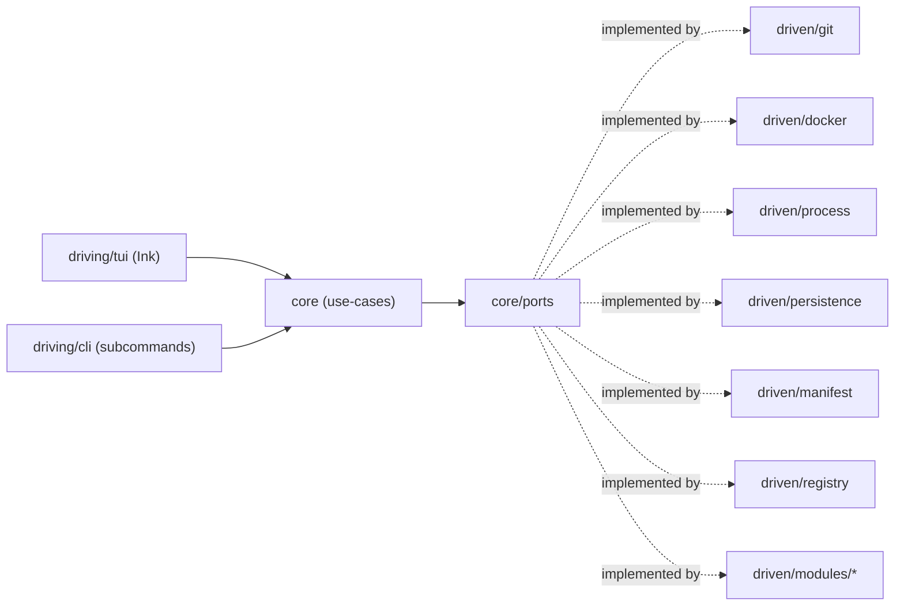

# Architecture Spine — tui-back

## Design Paradigm

Hexagonal (ports & adapters). The domain core owns EDT lifecycle, script orchestration, log aggregation, and the route explorer's browse/fire/save mechanics — company- and stack-agnostic by construction. Two families of adapters surround it: **driven** adapters the core reaches out through (git, Docker, subprocess, persistence, manifest, registry, and the company-specific modules), and **driving** adapters that reach into the core (the TUI and the CLI), both invoking the exact same use-cases so a script run by hand and a script triggered from the TUI are provably the same call.

```text
src/
  core/                     # domain + application layer — zero import of Ink/React/dockerode/child_process/better-sqlite3/fs
    edt/                    # EDT lifecycle, membership, branch registration
    scripts/                # script/subcommand use-cases: group-update, migrations, propagation...
    logs/                   # aggregation, windowing, fire-correlation
    routes/                 # browse/fire/save, saved-request library, learned affected-service sets
    ports/                  # GitPort, ContainerPort, ProcessPort, ManifestPort, EdtStorePort, GlobalStorePort,
                             # RegistryPort, RouteScannerPort, DevAuthPort, SharedTypesPort
  adapters/
    driven/
      git/                  # branch-scope safety gate lives here (AD-8)
      docker/                # dockerode
      process/               # child_process, structured stdout + exit code
      persistence/           # better-sqlite3: EdtStore, GlobalStore
      manifest/              # .tui-back.yaml read + zod validation
      registry/              # managed-repo path registry
      modules/
        shared-types/
        route-explorer/
          nestjs-openapi/    # implements RouteScannerPort for this backend
          jose-dev-jwt/      # implements DevAuthPort for this backend
    driving/
      tui/                   # Ink app — calls core use-cases only; one subfolder per zone (AD-15)
        dashboard/           # read-only aggregate across all zones
        edts/                # -> core/edt
        update/              # -> core/scripts
        logs/                # -> core/logs
        routes/              # -> core/routes
        shared-types/        # -> adapters/driven/modules/shared-types
        shared/               # cross-zone UI: list/detail split, modal-dialog, footer-hint (Atelier)
      cli/                   # subcommands — calls the same core use-cases
  bin/                       # CLI entrypoint
```

## Invariants & Rules

### AD-1 — Dependency direction is one-way, driving adapters never touch driven adapters directly

- **Binds:** all
- **Prevents:** a TUI-only side effect (the exact failure FR-1 rules out); adapters importing each other instead of going through core ports.
- **Rule:** `core/` never imports from `adapters/`. `adapters/driven/*` implement interfaces declared in `core/ports`. `adapters/driving/*` (`tui`, `cli`) call `core/` use-cases only — never a driven adapter directly.



### AD-2 — Script/CLI parity via one umbrella binary, shared core code — not TUI self-spawning

- **Binds:** FR-1
- **Prevents:** N independent build/package units and a duplicated arg-parsing/output-envelope implementation per script; a TUI that shells out to itself for every keypress-triggered action (process-spawn latency against the ~150ms budget, and the single-instance/state-sync problems that creates).
- **Rule:** every Must-scope action is a subcommand of one CLI binary (`tui-back <subcommand>`), a thin `driving/cli` wrapper around exactly one core use-case. The TUI (`driving/tui`, running inside the same long-lived process a developer launched) calls that **same core use-case directly, in-process** — it never spawns the CLI subcommand as a child process to perform its own actions. Parity comes from both driving adapters wrapping identical core code, not from the TUI shelling out to the CLI. A developer running the subcommand by hand, in a second terminal while the TUI is open, is the expected, supported way FR-1's "equally runnable" is exercised — see AD-9 for why that doesn't race the TUI unsafely.

### AD-3 — Script output envelope

- **Binds:** FR-1, every subcommand, and every core use-case's return shape (AD-2 — the TUI receives the same `data`/`error` shape as a return value that the CLI serializes to stdout)
- **Prevents:** hand-invocation and any future automation needing separate code paths, or a `--json` flag a developer has to remember.
- **Rule:** for the `cli` driving adapter: stdout is human-readable text when the process is attached to a TTY, and a single final JSON line otherwise — `{"ok":true,"data":{...}}` or `{"ok":false,"error":{"code":"...","message":"...","details":{...}}}`; exit code is `0` (success) or `1` (failure) only, finer-grained detail lives in `error.code`, never in exit-code taxonomy. Every core use-case returns exactly this `{ok,data}`/`{ok,error}` shape as its TypeScript return type — the CLI adapter serializes it to the envelope above, the TUI adapter consumes the same object directly (per AD-2), so the shape is identical everywhere even though only the CLI path renders it as text/JSON on stdout.

### AD-4 — Manifest is the only per-repo activation surface

- **Binds:** FR-2, FR-19, FR-20
- **Prevents:** activating a module, or onboarding a new repo, ever requiring a core code change.
- **Rule:** a repo is managed iff it carries a root `.tui-back.yaml`, zod-validated on load, declaring `service` (identity), `container` (docker-compose/container target name), optional `migrationCommand` (absent means the service has no migrations — a group update skips the migration step for it without error, FR-10/FR-12), optional `sharedBranch` (default `development` — FR-8), and `modules` (map of module-id → per-module config, e.g. `route-explorer: {scanner: nestjs-openapi, auth: jose-dev-jwt}`). A repo or module absent from a manifest is invisible to every tool action — no special-case code anywhere in `core/`.

### AD-5 — Module implementations are statically registered, never dynamically loaded

- **Binds:** FR-2, FR-19, FR-20
- **Prevents:** an arbitrary-code-execution surface on a tool holding real (if scoped) git write authority.
- **Rule:** the tool ships a compiled-in registry mapping module id → implementation. A manifest's `modules` entry only selects a key from that registry — it never points at externally loaded code. Adding a new module *implementation* (e.g. a scanner for a future Java service) is a code change inside `adapters/driven/modules/`; *activating* an existing implementation on a repo is manifest-only and touches no code.

### AD-6 — Repo registry is explicit, never path-convention-based

- **Binds:** FR-2, repo discovery
- **Prevents:** hardcoding a single-machine directory layout that breaks the moment a teammate's machine is laid out differently.
- **Rule:** the set of local filesystem paths the tool scans lives in an explicit registry (`XDG_CONFIG_HOME/tui-back/registry.yaml`), populated by an explicit register action. A separate scan subcommand may walk a given root (or the home directory) proposing `.tui-back.yaml`-carrying candidates, but it only proposes — it never auto-registers.

### AD-7 — Storage topology and schema-migration mechanism

- **Binds:** FR-3, FR-5, FR-6, FR-21, FR-23
- **Prevents:** a future EDT-rename feature forcing a file rename/migration; durable and transient state colliding on the same XDG tier; a crash or bug in one EDT corrupting another EDT's state or reaching into the narrowly-scoped global store (blast-radius isolation, PRD Cross-Cutting NFRs).
- **Rule:** one SQLite file per EDT at `XDG_DATA_HOME/tui-back/edts/<ulid>.db` — filename is a generated ULID, never the topic (the topic is a field inside the file; FR-3's uniqueness check reads across existing files). One global store at `XDG_DATA_HOME/tui-back/global.db` (saved-request library, per-EDT hide/favorite flags, global favorites) — deliberately narrow, so a bug in it can't touch EDT-specific state and vice versa. Active-EDT pointer and transient UI state (last-used EDT, log-view scroll position, per-zone splitter pane sizes — `EXPERIENCE.md`'s splitter component pattern requires these to persist across sessions, independently per zone) live at `XDG_STATE_HOME/tui-back/state.json`, never inside a `.db`. Each `.db`'s own schema evolves through hand-rolled, numbered `.sql` files tracked by a `schema_version` table — no external migration framework.

### AD-8 — Git-adapter enforces branch-scope safety centrally

- **Binds:** FR-6, FR-7, FR-8, FR-10, FR-11, FR-15
- **Prevents:** a call site forgetting the rule and reaching a destructive git operation outside its intended scope.
- **Rule:** every git write passes through `adapters/driven/git`, which rejects — before any `git` invocation — a write targeting `development`/preprod/prod or any branch not the current EDT's own registered branch for that service. The git-adapter resolves that allowed-branch context itself, by reading current EDT/manifest state directly at write time through `EdtStorePort`/`ManifestPort` — it never trusts a branch name passed in by the caller, closing the gap where a stale or malicious caller-supplied value could bypass the check. No commit or push happens without the developer's explicit approval at the moment it happens. Uncommitted work is always auto-preserved before a tool-triggered branch switch, and the resulting state is re-verified, never assumed.

### AD-9 — Single-TUI enforcement plus a per-EDT/repo action lock

- **Binds:** process lifecycle, all state-mutating use-cases
- **Prevents:** two concurrent writers to the same EDT's SQLite file or the same repo's git working tree — without also making a CLI subcommand run by hand (AD-2's supported pattern) refuse to start just because the TUI is open.
- **Rule:** two mechanisms, not one. (1) On startup, the **interactive TUI** (`driving/tui`) detects an already-running TUI instance on the same machine and refuses to start a second one — this lock is scoped to the TUI only, never to a `cli` subcommand invocation, so running a script by hand alongside an open TUI (AD-2) is never blocked by it. (2) Independently, any state-mutating core use-case acquires a short-lived advisory lock scoped to the specific EDT id / repo path(s) it touches (held for the action's duration, released after) before performing its writes — so two concurrent CLI invocations, or a CLI invocation racing the TUI's own in-flight action on the same EDT/repo, are serialized or rejected instead of corrupting state, regardless of how many TUI or CLI processes are alive.

### AD-10 — One central TUI store for cross-zone state; zone-local UI state stays local

- **Binds:** FR-6, FR-9, FR-10, FR-11, FR-12, FR-16, FR-17, FR-18
- **Prevents:** per-zone state fragmentation losing track of which of several concurrent things changed; the store silently going stale when something outside the TUI changes shared state.
- **Rule:** cross-zone state (active EDT, per-service status, log buffers, in-flight run status) lives in one Zustand store, written to by core use-case results. Zone-local UI state (list cursor, scroll position) stays component-local `useState`. `state.json` (AD-7) is the durable, authoritative record of the active EDT and other persisted transient state — the store's `activeEdt` field is a hydrated cache of it, loaded at TUI startup and re-synced (via `fs.watch` on `state.json`, or an equivalent poll) so a change made by a CLI invocation while the TUI is open is picked up, never silently stale. The store's `logBuffers` field holds only the current rendered/debounced window sourced from `core/logs` (AD-11) — it is a view onto that buffer, not a second independent copy of it.

### AD-11 — Logs are ephemeral; Docker remains the log-truth source

- **Binds:** FR-16, FR-17, FR-22
- **Prevents:** unbounded local log storage growth, and a second, tool-owned source of log truth that can drift from Docker's; two divergently-bounded copies of the same stream existing at once.
- **Rule:** `adapters/driven/docker` only streams raw lines in; the bounded in-memory ring buffer per service — sized to cover FR-22's fire-correlation window plus session scroll-back — is owned and windowed by `core/logs`, the single place buffering happens. Nothing is written to disk; the buffer is discarded on tool restart. The TUI store's `logBuffers` (AD-10) is a read view onto this buffer, not a second buffer.

### AD-12 — Performance budget: ~150ms interaction, debounced log rendering, never block the event loop

- **Binds:** FR-16, Cross-Cutting NFR (performance)
- **Prevents:** Ink's ~30 FPS render ceiling being hit by a naive full-redraw-per-line implementation; a CPU-heavy step run in-process stalling every other concurrent log stream and the UI itself, since Node's single-threaded event loop serves them all.
- **Rule:** UI interaction response stays under ~150ms; a log line is visible within ~1s of container emission. Log-stream re-renders are debounced/batched, never a full redraw per emitted line. CPU-heavy work is never run synchronously in-process on the TUI's event loop — long-running work goes through the CLI's subprocess boundary (AD-2's other invocation path) instead, which is also what keeps this an I/O-bound workload the event-loop model handles well (research finding). Ink's commonly cited "~30 FPS / >50MB" ceiling traces to secondary sources (via the 2026-08-07 research doc), not an independently re-verified primary source this run — treat it as a directional risk estimate, not a precise number to build against. OpenTUI is the pre-identified fallback if the ceiling is observed as a real problem in practice (SM-8) — not built pre-emptively; note it trades the same-ecosystem React/TS API for a second runtime dependency (Bun), not a drop-in library swap.

### AD-13 — Testing strategy by layer

- **Binds:** all
- **Prevents:** core business logic ending up covered only by fragile end-to-end TUI tests, or left untested altogether, on the excuse that "Ink is hard to test."
- **Rule:** `core/` is unit-tested (Vitest) against fake port implementations — no real git/docker/sqlite in these tests. `adapters/driven/*` get targeted integration tests against the real system (temp file for persistence, temp repo for git). The Zustand store is tested directly, without rendering Ink. `adapters/driving/cli` is tested black-box — invoke a subcommand as a child process, assert the AD-3 envelope on stdout/exit code — which doubles as the executable spec of that contract. `adapters/driving/tui` gets smoke-tests via Ink's own `render()` only, not exhaustive render coverage — an accepted trade-off given `ink-testing-library` has no actively-maintained current version (last released ~2 years ago, predates Ink 7/React 19), since `core` and the store already carry the real logic coverage.

### AD-14 — Packaging is deferred

- **Binds:** deployment envelope
- **Prevents:** premature packaging investment before teammate distribution is a real goal, and a build artifact nobody keeps in sync with actual daily usage (which stays `tsx`/`node`).
- **Rule:** v1 runs via `tsx`/`node` directly (a `package.json` bin, `npm link` for a local global command) — no compiled binary. A packaging mechanism (Node SEA / `pkg` / `bun --compile`) is chosen only when teammate distribution becomes a real goal, not before.

### AD-15 — TUI zone structure mirrors core capability boundaries 1:1

- **Binds:** TUI navigation structure (Atelier UX spine's 6 zones)
- **Prevents:** a zone's screen logic reaching across multiple unrelated core modules ad hoc, decoupling the UI's navigation model from the hexagonal capability split it's meant to present.
- **Rule:** each zone under `adapters/driving/tui/` maps to exactly one core capability area — `edts/`→`core/edt`, `update/`→`core/scripts`, `logs/`→`core/logs`, `routes/`→`core/routes`, `shared-types/`→`adapters/driven/modules/shared-types` — except `dashboard/`, which is the one zone allowed to read (never write) across all of them for its aggregate view. Cross-zone visual components shared by the Atelier spine (list/detail split, modal-dialog, footer-hint) live in `tui/shared/`, imported by zones, never duplicated per zone.

## Consistency Conventions

| Concern | Convention |
| --- | --- |
| Naming (entities, files, interfaces, events) | kebab-case files/directories; `PascalCase` types/classes; `camelCase` functions/variables. Manifest module ids are kebab-case strings (`shared-types-consumer`, `shared-types-source`, `route-explorer`), matched 1:1 against the compiled-in module registry (AD-5). |
| Data & formats (ids, dates, error shapes, envelopes) | Generated entity ids (EDT id, saved-request id) are ULIDs. Dates/times are ISO 8601. Script output envelope per AD-3: TTY → human text; non-TTY → single JSON line, `{ok:true,data}` or `{ok:false,error:{code,message,details}}`; exit code `0`/`1` only. `error.code` values are kebab-case strings (e.g. `unknown-subcommand`, `internal-error`) — set as precedent by Story 1.3, every use-case's error codes follow it. Any use-case that reports an outcome per service (FR-10 group update, FR-12 migrations, FR-14 propagation status, FR-15 propagation) puts it in `data.results: {service, outcome, detail?}[]`, `outcome` from a shared closed set (`"updated"`/`"skipped"`/`"failed"`, or the use-case's own equivalent) — one shape every zone/dashboard consumer can render uniformly instead of each script inventing its own. |
| State & cross-cutting (mutation, errors, logging, config, auth) | TUI cross-zone state lives in exactly one Zustand store (AD-10). Every git write passes through the git-adapter's branch-scope gate (AD-8) — never invoked directly from `core` or from `driving/*`. Module implementations resolve only via the compiled-in registry keyed by manifest module id (AD-5). Every script/subcommand use-case is idempotent — running it twice with no intervening state change produces no additional side effect (FR-1). |

## Stack

| Name | Version |
| --- | --- |
| TypeScript | 7.0.2 |
| Node.js | 24 (active LTS) |
| Ink | 7.1.1 (requires Node ≥22, React ≥19.2.0) |
| React | 19.2.8 |
| Zustand | 5.0.14 |
| better-sqlite3 | 13.0.3 |
| dockerode | 5.0.1 |
| openapi-typescript | 7.13.0 |
| jose | 6.2.8 |
| zod | 4.4.3 |
| yaml (eemeli) | 2.9.0 |
| ulid | 3.0.2 |
| vitest | 4.1.10 |
| tsx | 4.23.12 |

## Capability → Architecture Map

| Capability / Area | Lives in | Governed by |
| --- | --- | --- |
| 4.1 Standalone-Script Core & Manifest (FR-1, FR-2) | `core/scripts`, `core/ports`, `adapters/driven/manifest`, `adapters/driving/cli` | AD-2, AD-3, AD-4, AD-5 |
| 4.2 EDT Workspace Management (FR-3–FR-9) | `core/edt`, `adapters/driven/git`, `adapters/driven/persistence`, `tui/edts/` | AD-6, AD-7, AD-8, AD-15 |
| 4.3 Group Update & Migrations (FR-10–FR-12) | `core/scripts`, `adapters/driven/process`, `adapters/driven/git`, `tui/update/` | AD-2, AD-3, AD-8, AD-15 |
| 4.4 `shared-types` Propagation (FR-13–FR-15) | `adapters/driven/modules/shared-types`, `tui/shared-types/` | AD-4, AD-5, AD-15 |
| 4.5 Aggregated Log Observability (FR-16–FR-18) | `core/logs`, `adapters/driven/docker`, `tui/logs/` | AD-10, AD-11, AD-12, AD-15 |
| 4.6 Route Explorer (FR-19–FR-23) | `core/routes`, `adapters/driven/modules/route-explorer/*`, `adapters/driven/persistence` (`global.db`), `tui/routes/` | AD-4, AD-5, AD-7, AD-10, AD-15 |

## Deferred

- **Exact FR-22 correlation-window duration** — the mechanism (bounded in-memory ring buffer, AD-11) is fixed here; the window's size is a UX/tuning call for `bmad-ux` or empirical adjustment once the tool is in daily use.
- **Packaging mechanism specifics** (Node SEA vs `pkg` vs `bun --compile`) — AD-14 defers the choice itself until teammate distribution is a real goal.
- **Validating the generic-core/module split against a second, structurally different stack** (gateway-less Java/Python) — explicitly out of v1 scope (PRD §5, §6.2); this spine's module boundary (AD-4, AD-5) is built to make that validation possible later, not to prove it now.
- **AI-assisted manifest bootstrapping** (PRD §6.2, Could-scope) — the manifest schema it would target is fixed here (AD-4); building the bootstrapping skill itself stays deferred.
- **Internal tool-diagnostic logging** (the tool's own debug logs, distinct from the aggregated container logs of AD-11) — not required by any FR; add only if debugging the tool itself in daily use turns out to need it.
- **Single-instance detection mechanism** (lock file vs PID check vs OS-level lock) — AD-9 fixes that it must happen; the concrete technique is an implementation detail with no cross-builder divergence risk worth fixing here.
- **Guided onboarding/installation wizard** — explicitly out of scope for v1 (PRD §6.2).
- **OpenTUI migration** — only evaluated if Ink's FPS/memory ceiling is actually observed as a problem in practice (SM-8), per AD-12.
- **`XDG_CACHE_HOME`** — named by the PRD's local-state-layout NFR, but no cacheable derived data (e.g. a resolved OpenAPI schema) was identified during this run; left unused until one emerges.
- **Canonical route-identity key across `RouteScannerPort` implementations** (method+path vs an opaque id) — the PRD doesn't specify one scheme, and different scanner implementations (NestJS/OpenAPI today, a future language's scanner later) may have different natural identities; left to each `RouteScannerPort` implementation's own contract, revisit only if a second implementation actually struggles to agree with the first on what identifies "the same route" for FR-21's saved-request matching.
- **Mouse-input capture mechanism** — the UX spine (`EXPERIENCE.md`, Responsive & Platform) names mouse-drag splitter resize as a target interaction but flags it as "a flagged architecture risk, not a settled capability" since Ink has no built-in mouse support; `Ctrl+W` keyboard resize-mode is the confirmed-safe fallback specified everywhere this matters (Interaction Primitives). Which concrete mechanism would capture terminal mouse events for Ink (e.g. a terminal mouse-escape-sequence parsing library, or an Ink-compatible input hook) is left open here — implement and validate during Story 1.10; fall back to `Ctrl+W`-only if none proves reliable across the target terminals.
